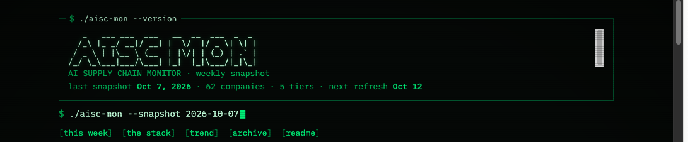

**Live:** https://mehrabiani.com/projects/aisc/

This project was inspired by a Youtube video https://www.youtube.com/watch?v=p8UurM1wvvM

As fascinating as the science behind chip-making is, a business has to make each and every part. Another company packages it, and others sell the power, etc. This was the idea behind the AI Supply Chain Monitor. It auto-updates every Monday (hopefully) and was built with Claude, Fable 5.1 and Opus 5. I had the idea to turn it into a hacker-like terminal because it just looks so cool to me. It was supposed to be a personal project I can send to friends. Anyway, this is my first time posting on here, encouraged by those friends. Hope this is useful.

## Files

- `index.html` — the page, exactly as deployed. Plain HTML with no build step; it reads JSON from `../../data/aisc/` on the site.
- `scripts/aisc_update.py` — installs a week's snapshot and brief and rebuilds the manifest. It refuses malformed dates, unknown tickers, and any week where fewer than half the companies carry a market cap.
- `data/README.md` — the data contract. The data itself lives on the site: https://mehrabiani.com/data/aisc/manifest.json
